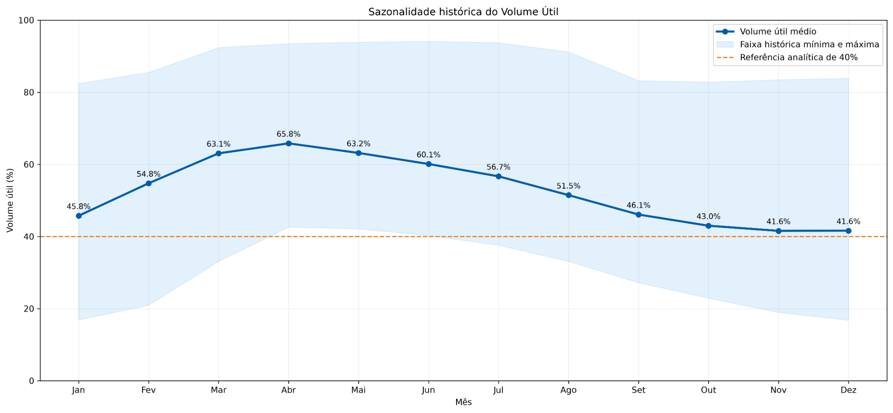
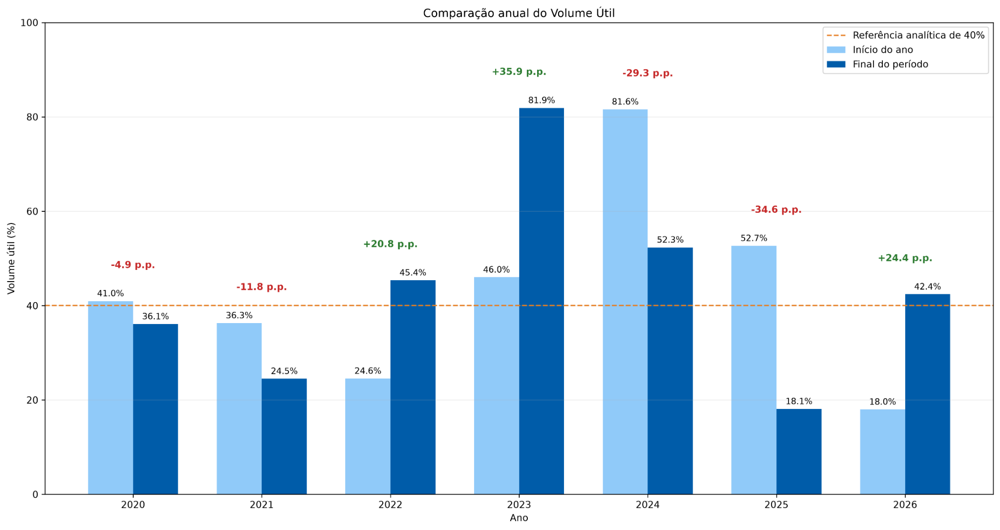
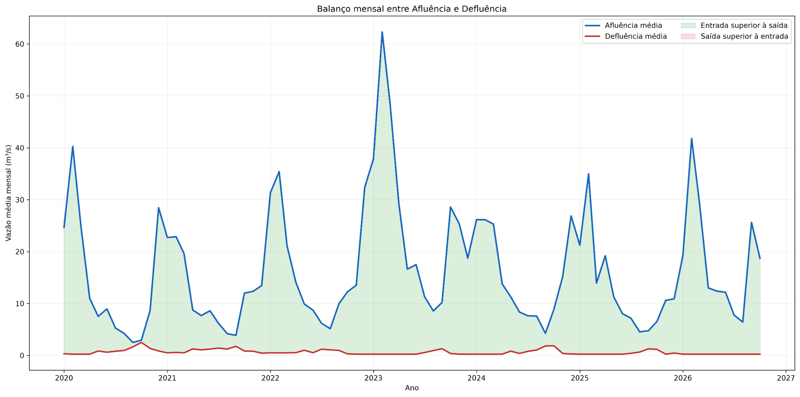

# Projeto Água em Foco

## Análise histórica do Reservatório Jaguari-Jacareí

Projeto de portfólio em análise de dados com foco em diagnóstico da fonte, tratamento, validação de série temporal, construção de indicadores, análise sazonal e comunicação executiva.

A análise contempla **2.474 medições diárias**, entre **01/01/2020 e 09/10/2026**.

## Destaques

- **Volume útil mais recente:** 42,42% em 09/10/2026.
- **Recuperação em 2026:** +24,4 pontos percentuais até 09/10/2026.
- **Menor volume útil:** 16,79% em 09/12/2025.
- **Maior volume útil:** 94,11% em 17/06/2023.
- **Maior afluência diária:** 131,83 m³/s em 04/02/2023.
- **Qualidade da base final:** 2.474 registros, sem datas duplicadas e sem valores numéricos ausentes.

## Problema e abordagem

O arquivo original possuía extensão `.xls`, mas armazenava uma tabela HTML. A fonte foi diagnosticada, importada com `pandas.read_html()`, padronizada e validada antes da construção das análises.

Etapas executadas:

1. diagnóstico do formato real do arquivo;
2. leitura e estruturação da tabela;
3. correção de datas e casas decimais;
4. validação de duplicidades, continuidade e valores ausentes;
5. interpolação documentada do registro de 25/09/2026;
6. geração de indicadores, tabelas e gráficos;
7. criação do relatório executivo.

## Visualizações

### Sazonalidade histórica



A média histórica cresce de 45,8% em janeiro para 65,8% em abril e diminui gradualmente no segundo semestre.

### Comparação anual



A série apresentou recuperação em 2022, 2023 e no período parcial de 2026. As maiores retrações ocorreram em 2024 e 2025.

### Afluência e defluência



A comparação direta entre afluência e defluência funciona como indicador analítico, mas não representa o balanço hídrico integral.

## Estrutura

```text
Projeto_Agua_em_Foco_Portfolio/
├── notebooks/
│   └── Analise_Cantareira_Portfolio.ipynb
├── graficos/
│   ├── 07_sazonalidade_historica_volume.png
│   ├── 08_comparacao_anual_volume_util.png
│   └── 09_balanco_mensal_vazoes.png
├── resultados/
│   └── tabelas_analiticas_cantareira_final.xlsx
├── relatorio/
│   ├── Relatorio_Executivo_Agua_em_Foco.docx
│   └── Relatorio_Executivo_Agua_em_Foco.pdf
├── requirements.txt
└── README.md
```

## Como executar

```bash
python -m venv .venv
```

No Windows:

```bash
.venv\Scripts\activate
pip install -r requirements.txt
```

Depois, abra `notebooks/Analise_Cantareira_Portfolio.ipynb` no Visual Studio Code ou Jupyter e execute **Run All**.

## Tecnologias

- Python 3
- pandas
- NumPy
- Matplotlib
- openpyxl
- Jupyter Notebook
- Visual Studio Code

## Entregáveis

- [Notebook reproduzível](notebooks/Analise_Cantareira_Portfolio.ipynb)
- [Planilha analítica final](resultados/tabelas_analiticas_cantareira_final.xlsx)
- [Relatório executivo em PDF](relatorio/Relatorio_Executivo_Agua_em_Foco.pdf)
- [Relatório editável em Word](relatorio/Relatorio_Executivo_Agua_em_Foco.docx)

## Limitações

- O estudo contempla somente o reservatório Jaguari-Jacareí.
- O ano de 2026 é parcial até 09/10/2026.
- O registro de 25/09/2026 foi preenchido por interpolação linear.
- Não foram incorporados dados de precipitação, evaporação, temperatura ou regras operacionais.
- A referência de 40% usada nos gráficos possui finalidade exclusivamente analítica.
- As classificações apresentadas não possuem caráter oficial, operacional ou regulatório.

## Competências demonstradas

Tratamento de dados, validação de séries temporais, análise exploratória, sazonalidade, indicadores, visualização, automação de exportações e comunicação executiva.

## Autor

**Tiago Moreira**  
Projeto desenvolvido como estudo de portfólio em análise de dados.
